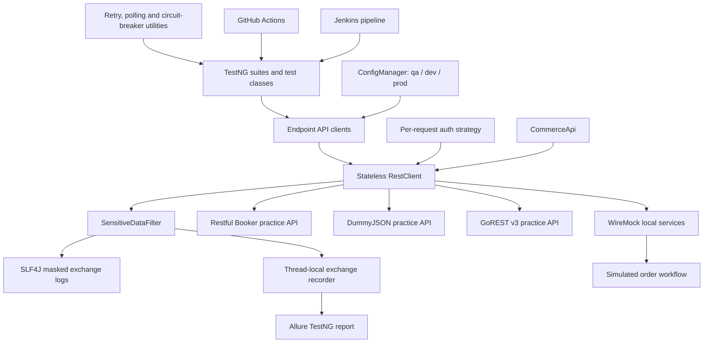

# Framework Architecture

This project tests three public practice APIs and a separate WireMock-backed storefront simulation. The practice APIs do not share identities or persistence with one another. The commerce workflow is simulated and does not represent Amazon's internal services.

## Responsibilities

| Layer | Responsibility |
|---|---|
| TestNG tests | Define scenarios, create unique data, assert response contracts and clean up resources |
| Endpoint clients | Map service operations to HTTP methods and paths without owning test assertions |
| `RestClient` | Create a fresh RestAssured request specification per operation, apply a base URL and perform HTTP calls |
| Authentication | Add authentication to an individual request, avoiding shared client auth state |
| `ConfigManager` | Load environment defaults and overlay system-property/environment-variable overrides |
| `SensitiveDataFilter` | Log HTTP exchanges with credential and personal-data masking; record sanitized exchanges for Allure |
| Resilience utilities | Provide bounded retry, polling and circuit-breaker examples; retry safety remains the caller's responsibility for generic actions |
| WireMock | Provide isolated local endpoints for unsupported commerce services and deterministic failures |
| CI pipelines | Run the tagged groups, retain Surefire/Allure results and fail the build when a required stage fails |

## Execution boundaries

- `testng.xml` runs the broader suite, including public practice APIs and local simulations.
- `testng-parallel.xml` limits execution to parallel-safe tests and avoids concurrent traffic to public APIs.
- `src/test/resources/suites/ci-mocking.xml` lists only local mock-backed test classes. The smoke, regression and end-to-end suites select methods by TestNG group.
- Tests for unsupported order, inventory, payment, shipment, notification and refund services use local WireMock servers. They do not send requests to real payment providers.
- Each `RestClient` request starts with a new request specification. Authentication and headers are set on the request, not retained on the client.
- The TestNG context and report exchange capture use thread-local storage and are cleared after each test invocation.

See [the endpoint inventory](api-endpoint-inventory.md) for service paths and [the coverage matrix](test-coverage-matrix.md) for scenario categories.
